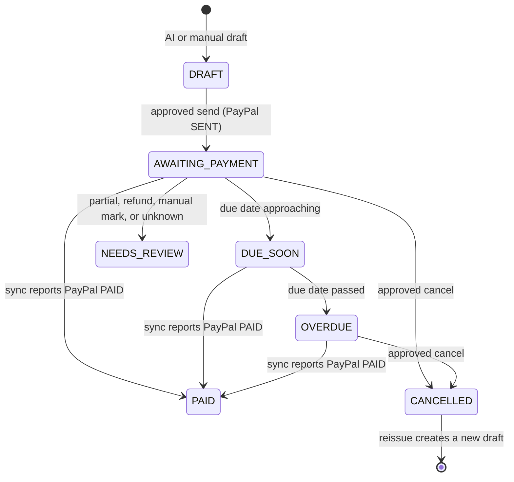
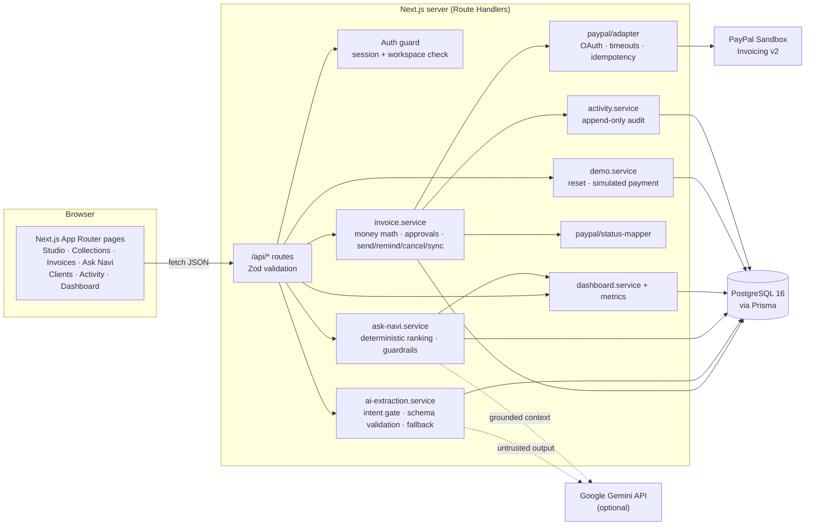
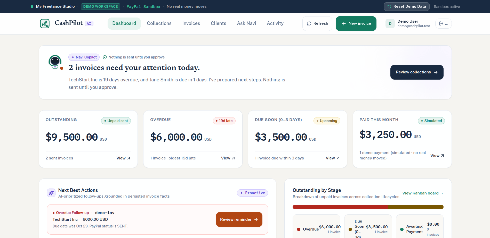
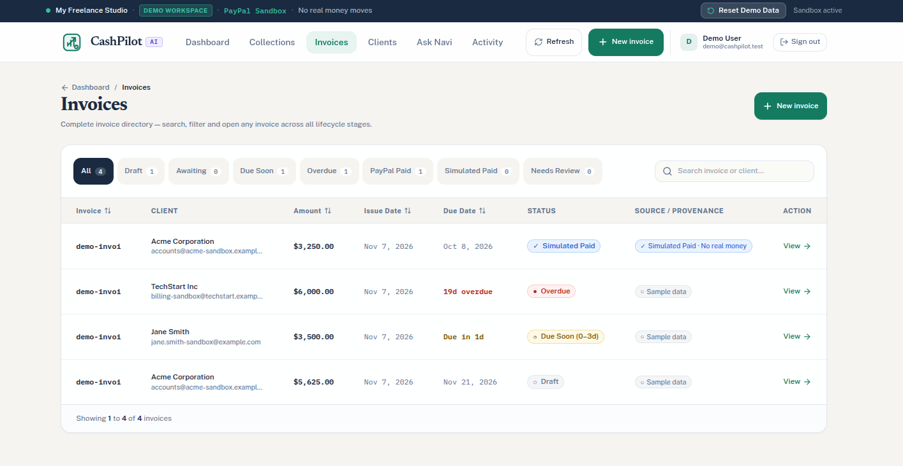
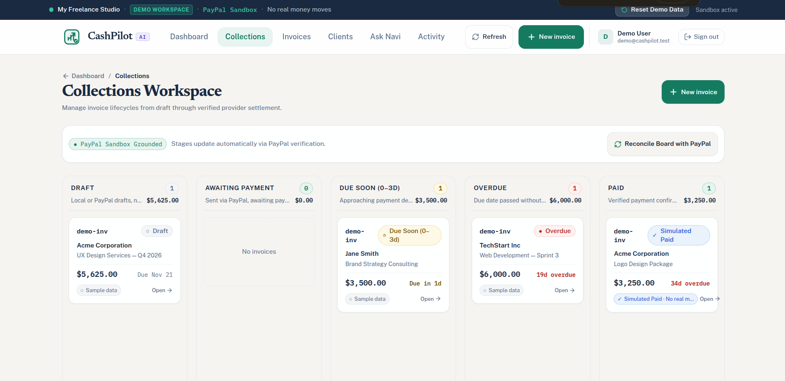
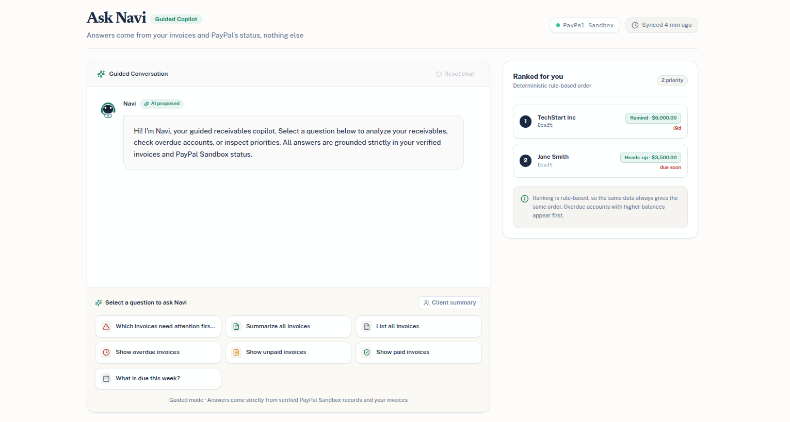
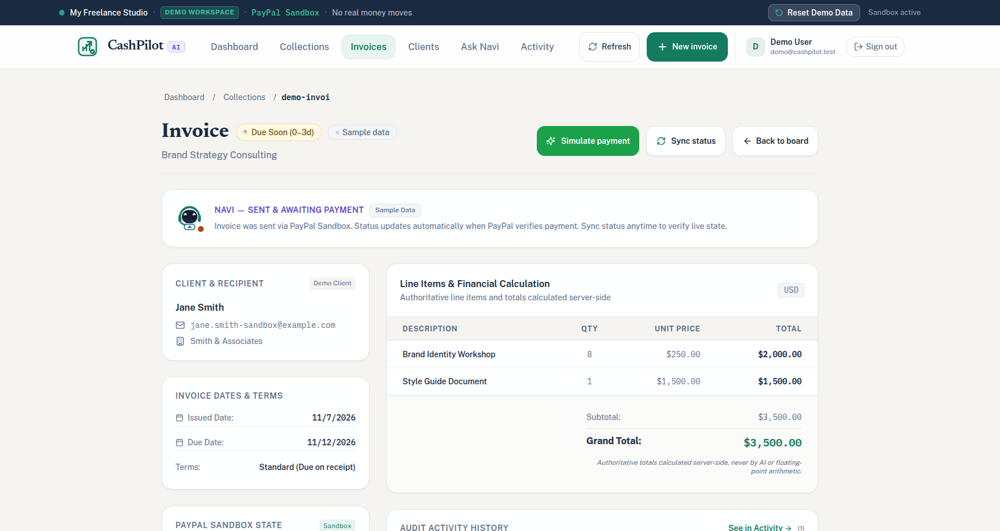
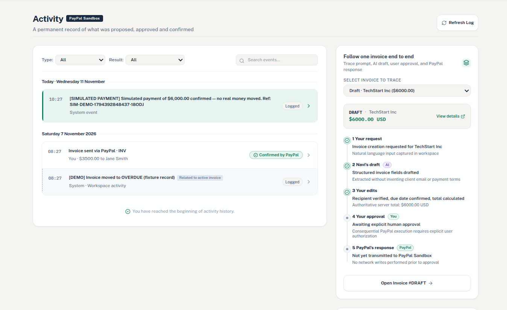

# CashPilot AI

> **An AI receivables copilot for freelancers and small service businesses: describe the work in plain English, approve the result, and let PayPal Sandbox confirm whether you've been paid.**

[](https://nextjs.org/)
[](https://react.dev/)
[](https://www.typescriptlang.org/)
[](https://tailwindcss.com/)
[](https://www.prisma.io/)
[](https://www.postgresql.org/)
[](https://developer.paypal.com/)
[](LICENSE)

_Built for the PayPal AI Hackathon._

<p align="center"><b>AI proposes. The user approves. PayPal verifies.</b></p>

---

## Table of Contents

- [The problem](#the-problem)
- [The solution](#the-solution)
- [Implemented features](#implemented-features)
- [How the AI copilot works](#how-the-ai-copilot-works)
- [PayPal integration](#paypal-integration)
- [Architecture](#architecture)
- [Screenshots](#screenshots)
- [Getting started](#getting-started)
- [Testing and verification](#testing-and-verification)
- [API Documentation](#api-documentation)
- [Demo walkthrough](#demo-walkthrough)
- [Known limitations](#known-limitations)
- [Team](#team)

---

## The problem

Freelancers, consultants and small agencies spend unpaid hours on receivables:

- Turning a scope of work into an invoice means typing line items, rates, tax and due dates by hand.
- Invoices, client emails and spreadsheets live in different places, so it's hard to see who owes what.
- Follow-ups depend on memory. Overdue invoices slip and reminders feel awkward.
- A _sent_ invoice gets mistaken for _collected_ cash, so cash-flow numbers are wrong.

**Target users:** solo freelancers, independent consultants and small service businesses that bill clients through PayPal.

## The solution

**Live Demo:** [cash-pilot-mocha.vercel.app](https://cash-pilot-mocha.vercel.app/)

CashPilot is one workspace for drafting invoices, tracking collections and following up, with an AI copilot that does the tedious parts. The AI never gets the final say on money.

|                           | A plain invoicing dashboard          | CashPilot AI                                                                                  |
| :------------------------ | :----------------------------------- | :-------------------------------------------------------------------------------------------- |
| **Creating an invoice**   | Fill in every form field yourself    | Describe the work in plain English; AI drafts the client, line items, tax, terms and due date |
| **Knowing what to chase** | Sort a table and decide              | Ask Navi ranks overdue invoices and shows the evidence behind each ranking                    |
| **Payment truth**         | Often a manual "mark as paid" toggle | `PAID` is set only from PayPal-reported status                                                |
| **Safety**                | Actions run on click                 | Each PayPal write needs an explicit approval tied to the exact invoice contents               |
| **Traceability**          | Limited history                      | Append-only log of AI drafts, approvals, PayPal calls and syncs                               |

The key difference is the trust model. The AI drafts and recommends, the server checks and calculates, the user approves, and PayPal is the authority on payment status.

---

## Implemented features

| Area                                                    | What exists in this repository                                                                                                                                                                                                                |
| :------------------------------------------------------ | :-------------------------------------------------------------------------------------------------------------------------------------------------------------------------------------------------------------------------------------------- |
| **Invoice Studio** (`/invoices/new`)                    | A three-step wizard (Describe → Review → Confirm with PayPal). Turns a plain-English prompt into a structured draft, flags missing fields, matches known clients, lets you add a client inline, and lets you edit everything before approval. |
| **Server-side money math**                              | Line, subtotal, tax and total amounts are calculated on the server in integer minor units (cents), with tax in basis points. The AI never supplies authoritative totals.                                                                      |
| **Approval gate**                                       | Approvals are stored with a SHA-256 hash of the invoice's material fields and expire after 15 minutes. If a material field changes, the hash no longer matches and the approval is rejected. Covers send, reminder and cancel actions.        |
| **PayPal Sandbox lifecycle**                            | Create a draft, send, remind, cancel, and sync status for one invoice or the whole workspace. Stores PayPal invoice IDs, raw provider status and the payer-view link.                                                                         |
| **Collections board** (`/collections`)                  | Kanban columns for Draft, Awaiting Payment, Due Soon, Overdue and Paid. Cancelled and needs-review invoices are kept off the board. Dragging a card to Paid is blocked and points you to a PayPal status refresh.                             |
| **Dashboard** (`/`)                                     | Outstanding, overdue and paid metrics in integer minor units. Only invoices that PayPal confirmed as sent count as outstanding. Cards link to filtered invoice lists.                                                                         |
| **Ask Navi** (`/navi-ai`)                               | A receivables assistant that answers from workspace records: priorities, overdue, unpaid, paid, due today or this week, and per-client summaries. It refuses requests to mark invoices paid, change status, or send messages on its own.      |
| **Invoices and detail** (`/invoices`, `/invoices/[id]`) | A paginated list with filters, plus a detail page showing PayPal and CashPilot status side by side, payment details, a journey tracker, and actions for send, remind, cancel, sync, and reissuing a cancelled invoice.                        |
| **Clients** (`/clients`)                                | Workspace-scoped client directory with create, edit and search. Clients that already have invoices can't be deleted.                                                                                                                          |
| **Activity history** (`/activity`)                      | An append-only audit feed of invoice, AI, approval, PayPal operation and sync events.                                                                                                                                                         |
| **Auth and workspaces**                                 | Email/password signup and login with scrypt hashing, database-backed sessions stored as SHA-256 token hashes, in-memory rate limiting on auth routes, workspace isolation checks, a profile page, and one-click demo workspace access.        |
| **Demo tools**                                          | Demo workspace reset, plus clearly labelled **simulated** payments that only work on demo invoices (see [Simulated vs. PayPal-verified payments](#simulated-vs-paypal-verified-payments)).                                                    |
| **API docs**                                            | An OpenAPI 3.1 document at `/api/openapi.json` and Swagger UI at `/api-docs`.                                                                                                                                                                 |

---

## How the AI copilot works

### 1. Natural-language invoice drafting

Example prompt: _"Bill Acme Corp for 12 hours of design consulting at $150/hr plus a $400 logo package, 10% tax, due in 14 days, with a thank-you note."_

1. **Intent gate.** A fast, deterministic check rejects input that isn't a billing request (small talk, trivia, code requests, gibberish) before any model is called.
2. **Grounded extraction.** When `AI_PROVIDER=google` and a key is set, the prompt and the workspace's known clients go to Google Gemini with a request for JSON. The model can also mark the request as not an invoice.
3. **Validate.** The model's output is treated as untrusted and parsed against a Zod schema on the server. Missing emails or dates go into `missingFields` instead of being guessed.
4. **Fallback.** If AI isn't configured, times out (10 s) or returns invalid output, a deterministic extractor runs instead. Every result is labelled `ai_model` or `deterministic_rule_based`, so fallback output is never shown as AI output.
5. **Server totals.** The server recomputes every amount in integer minor units, and the draft is saved for the user to review and edit.

### 2. Ask Navi: receivables guidance

- Common questions, such as _"Which invoices need attention first?"_, _"How much is overdue?"_ and _"Summarize Acme"_, go to **deterministic handlers** over saved invoice and PayPal-sync data. The same data always gives the same ranking, and each ranking shows its evidence: days overdue, amount, PayPal status and reminders already sent.
- Open-ended questions can go to Gemini, but only with a summary of the workspace's invoices as context. The reply is screened again so it can't claim it executed an action.
- Suggested actions only **open** an invoice or a draft. Navi never sends, cancels, or marks anything paid.

### What stays under user control

| The AI may                                                               | Only the user (via the approval gate) or PayPal may                  |
| :----------------------------------------------------------------------- | :------------------------------------------------------------------- |
| Read the request and propose client, line items, tax, terms and due date | Approve the exact invoice contents for sending                       |
| Flag missing or ambiguous information                                    | Send, remind or cancel through PayPal                                |
| Rank overdue invoices and explain why                                    | Change an invoice to `PAID` (PayPal status only)                     |
| Suggest next steps                                                       | Simulate a demo payment (explicit confirmation, demo workspace only) |

---

## PayPal integration

All PayPal calls run on the server, in [`src/lib/paypal/adapter.ts`](src/lib/paypal/adapter.ts). Credentials and OAuth tokens never reach the browser. The environment schema **only accepts Sandbox**: `PAYPAL_ENV` must be `sandbox` and `PAYPAL_BASE_URL` must be a Sandbox URL.

| Capability                         | PayPal API used                           | CashPilot route                                                             |
| :--------------------------------- | :---------------------------------------- | :-------------------------------------------------------------------------- |
| OAuth 2.0 client-credentials token | `POST /v1/oauth2/token`                   | (internal)                                                                  |
| Create draft invoice               | `POST /v2/invoicing/invoices`             | `POST /api/invoices/{id}/paypal-draft`                                      |
| Send invoice to the recipient      | `POST /v2/invoicing/invoices/{id}/send`   | `POST /api/invoices/{id}/send`                                              |
| Send payment reminder              | `POST /v2/invoicing/invoices/{id}/remind` | `POST /api/invoices/{id}/remind`                                            |
| Cancel a sent invoice              | `POST /v2/invoicing/invoices/{id}/cancel` | `POST /api/invoices/{id}/cancel`                                            |
| Status refresh / reconciliation    | `GET /v2/invoicing/invoices/{id}`         | `POST /api/invoices/{id}/sync`, `POST /api/invoices/sync` (whole workspace) |

### Invoice lifecycle



While an invoice is in `DRAFT`, an approval tied to its exact contents creates the PayPal draft. Sending it needs a separate approval. `DUE_SOON`, `OVERDUE` and the other states are CashPilot workflow states, derived from PayPal's raw status and the due date.

### Reliability and safety rules in the code

- **Two separate statuses.** Each invoice stores PayPal's raw status (`paypalStatus`, `paypalStatusRaw`) next to CashPilot's workflow status (`cashpilotStatus`). One tested mapper, [`status-mapper.ts`](src/lib/paypal/status-mapper.ts), converts between them.
- **Unknown statuses are never treated as paid.** `PARTIALLY_PAID`, `MARKED_AS_PAID`, refunds and any unrecognised status map to `NEEDS_REVIEW`.
- **Timeouts.** Every PayPal call has a time limit. A timed-out write is saved as an `UNKNOWN` outcome and has to be reconciled before it can be retried.
- **Duplicate protection.** Writes send a `PayPal-Request-Id` idempotency key and are tracked in `ExternalOperation` records.
- **Stale status.** If a refresh fails, the invoice is flagged `syncIsStale` and keeps its last known status.
- **Pull-based sync.** Status updates only when a user runs a sync for one invoice or the whole workspace. Webhooks aren't implemented.

### Simulated vs. PayPal-verified payments

> [!IMPORTANT]
> **Simulated payments are not real transactions.** No money moves and PayPal is never called.

To show the "paid" end of the journey without making a real Sandbox payment, the **demo workspace** has a _Simulate Payment_ action:

- It works only for the seeded demo user, inside `demo-workspace-1`, on invoices flagged `isDemoData`. The server rejects every other case.
- It needs explicit confirmation in a modal. Ask Navi refuses to simulate payments.
- It sets `cashpilotStatus = SIMULATED_PAID` and `paymentProvenance = SIMULATED_DEMO_PAYMENT`. These are kept apart from `PAID` / `PAYPAL_VERIFIED`.
- The UI labels it as a simulated payment, and the audit log records it with a `[SIMULATED PAYMENT] … no real money moved` description.
- `SIMULATED_PAID` invoices aren't counted in _Paid This Month_. When a workspace has only demo data, the dashboard labels paid figures as simulated.

**Seeded data is fixture data too.** `npm run db:seed` creates demo clients and invoices flagged `isDemo` / `isDemoData`, and one of them is pre-seeded with `PAID` status. That record is a labelled fixture, not a PayPal-verified payment.

For invoices you create yourself, only a PayPal status sync can produce `PAID` with `PAYPAL_VERIFIED` provenance.

---

## Architecture

CashPilot is a single **modular-monolith** Next.js app. UI components, route handlers, domain services and the PayPal and AI adapters are kept in separate modules.



### Tech stack

| Layer     | Technology                                                                                    |
| :-------- | :-------------------------------------------------------------------------------------------- |
| Frontend  | Next.js 16 (App Router), React 19, Tailwind CSS 4, Radix UI primitives, lucide-react icons    |
| Backend   | Next.js Route Handlers, TypeScript (strict), Zod                                              |
| Data      | PostgreSQL 16 (Docker Compose), Prisma ORM 6 with migrations                                  |
| Providers | PayPal Sandbox Invoicing v2 REST API, Google Gemini `generateContent` (optional)              |
| API docs  | OpenAPI 3.1 document + `swagger-ui-react`                                                     |
| Testing   | Vitest (unit, service, route and component tests), Playwright (desktop and mobile Chrome E2E) |

### Data model (Prisma)

`User`, `Session`, `Workspace`, `Client`, `Invoice`, `InvoiceLineItem`, `AiDraft`, `Approval`, `ExternalOperation`, `ActivityEvent`. See [`prisma/schema.prisma`](prisma/schema.prisma).

### Repository layout

```text
src/app/            Pages and /api route handlers
src/components/     UI by feature (studio, collections, invoices, navi, ...)
src/lib/services/   Domain services (invoice, AI extraction, Ask Navi, activity, demo, ...)
src/lib/paypal/     PayPal adapter, status mapper, payment-detail parsing
src/lib/auth/       Password hashing, sessions, guard, rate limiting
src/lib/money.ts    Integer minor-unit money helpers
prisma/             Schema and migrations
e2e/                Playwright specs
scripts/            OpenAPI validation and PayPal Sandbox smoke checks
docs/               Product concept, SRS, UI design reference, wireframes
```

---

## Screenshots

- **Dashboard**

  

- **AI Invoice Studio**

  

- **Collections Kanban**

  

- **Ask Navi AI Copilot**

  

- **Invoice Details**

  

- **Activity History**

  

---

## Getting started

### Prerequisites

- Node.js 20+ and npm
- Docker with Docker Compose (for local PostgreSQL)
- Optional: a [PayPal Developer](https://developer.paypal.com/) Sandbox REST app (client ID and secret) for real Sandbox operations
- Optional: a Google Gemini API key for model-backed extraction and chat

### 1. Install

```bash
git clone https://github.com/Vedant1703/CashPilot.git
cd CashPilot
npm install
```

Open [http://localhost:3000](http://localhost:3000) in your browser.

### 2. Configure environment

```bash
cp .env.example .env
```

Use `.env` rather than only `.env.local`. The Prisma CLI, the Prisma client used by the seed script, and Docker Compose read `.env`, and Next.js reads it too. Both files are git-ignored. Never commit real values.

| Variable                                                             | Purpose                                                                                                                    |
| :------------------------------------------------------------------- | :------------------------------------------------------------------------------------------------------------------------- |
| `POSTGRES_USER`, `POSTGRES_PASSWORD`, `POSTGRES_DB`, `POSTGRES_PORT` | Docker Compose database settings (host port `5433` by default)                                                             |
| `DATABASE_URL`                                                       | PostgreSQL connection string. Must match the values above.                                                                 |
| `SESSION_SECRET`                                                     | Required by env validation, minimum 32 characters (`openssl rand -hex 32`)                                                 |
| `PAYPAL_ENV`                                                         | Must be `sandbox`                                                                                                          |
| `PAYPAL_CLIENT_ID`, `PAYPAL_CLIENT_SECRET`                           | Sandbox REST app credentials (server-side only)                                                                            |
| `PAYPAL_BASE_URL`                                                    | `https://api-m.sandbox.paypal.com`                                                                                         |
| `AI_PROVIDER`                                                        | `google` is the only provider wired to a model. `anthropic` and `openai` pass validation but use the deterministic engine. |
| `AI_API_KEY`, `AI_MODEL`                                             | Gemini key and model name (`.env.example` defaults to `gemini-1.5-pro`)                                                    |
| `NEXT_PUBLIC_APP_URL`                                                | Public app URL (`http://localhost:3000`)                                                                                   |
| `TEST_DATABASE_URL`                                                  | Optional override for the disposable test database (see [Testing](#testing-and-verification))                              |

> [!NOTE]
> The server validates all variables together. Keep every variable present, even if you're only using placeholders. If the AI key is missing or invalid, extraction and Ask Navi fall back to the deterministic engine. PayPal operations need real Sandbox credentials and return an error without them.

### 3. Start the database, migrate and seed

```bash
docker compose up -d     # PostgreSQL 16 on 127.0.0.1:5433
npm run db:generate      # generate the Prisma client
npm run db:migrate       # apply migrations in prisma/migrations (prisma migrate dev)
npm run db:seed          # seed the demo user, workspace, clients and invoices (labelled as demo data)
```

Other database scripts: `npm run db:migrate:deploy` (apply migrations without creating new ones), `npm run db:studio`, and `npm run db:reset` (**drops and recreates** the database).

### 4. Run

```bash
npm run dev
```

Open <http://localhost:3000>. Sign up for an account, or go to `/login` and use **Judge & Evaluator Quick Access → Explore Demo Workspace**.

---

## Testing and verification

```bash
npm run typecheck          # tsc --noEmit
npm run lint               # ESLint
npm run openapi:validate   # checks required paths in the OpenAPI document
npm test                   # Vitest
npm run test:e2e           # Playwright (starts `npm run dev` if no server is running)
```

The suite has 52 Vitest files in `src/lib/__tests__` and 7 Playwright specs in `e2e/`. They cover money math, status mapping, approval hashing, send/remind/cancel/sync safety, AI extraction, Ask Navi guardrails, auth, demo simulation and UI flows.

> [!WARNING]
> **Test database guard.** `vitest.config.ts` and `playwright.config.ts` refuse to run unless the target database is named exactly **`cashpilot_disposable_test`**. Create and migrate that database once before running tests, for example:
>
> ```bash
> docker exec cashpilot-postgres createdb -U cashpilot cashpilot_disposable_test
> DATABASE_URL="postgresql://cashpilot:<password>@127.0.0.1:5433/cashpilot_disposable_test?schema=public" npx prisma migrate deploy
> ```
>
> If your Postgres password isn't the Compose default, set `TEST_DATABASE_URL` to the same connection string.

Playwright mocks PayPal at the route level, so E2E runs never write to PayPal. For a manual Sandbox credential check, `npx tsx scripts/check-paypal-sandbox-auth.ts` requests an OAuth token only and creates nothing. The other `scripts/smoke-test-paypal-sandbox-*.ts` scripts **do** create, send, remind or cancel real Sandbox invoices.

---

## API Documentation

CashPilot ships an OpenAPI 3.1.0 specification covering 24 API paths and 29 HTTP operations. All 29 implemented route handlers are documented.

- **Spec source:** [`src/lib/openapi/document.ts`](src/lib/openapi/document.ts).
- **Interactive Swagger UI:** visit [`/api-docs`](http://localhost:3000/api-docs) in your browser.
- **OpenAPI 3.1.0 JSON spec:** available at [`/api/openapi.json`](http://localhost:3000/api/openapi.json).
- **Contract validation:** run `npm run openapi:validate`. It checks that every route handler and HTTP method under `src/app/api` is documented, and that every documented operation has a handler, plus OpenAPI structure, unique operation IDs, declared tags, path parameters, error-code/status consistency, internal `$ref`s, and that the spec resolves through Swagger's client.

Recently added to the spec: `PATCH /api/invoices/{id}`, `POST /api/invoices/{id}/reissue`, `POST /api/invoices/{id}/simulate-payment`, `POST /api/demo/reset`, and `GET`/`PATCH /api/user/profile`.

The validator checks coverage and spec structure. It does not call endpoints, so documented response fields and runtime behavior come from reviewing the handlers rather than exhaustive testing.

---

## Demo walkthrough

A suggested 5-minute path for judges:

1. **Enter the demo.** On `/login`, choose _Explore Demo Workspace_. The dashboard shows outstanding, overdue and paid totals from seeded demo invoices.
2. **Ask Navi.** Open `/navi-ai` and ask _"Which invoices need attention first?"_. You get a ranked list with evidence. Then try _"Mark INV-… as paid"_ and watch Navi refuse.
3. **Draft with AI.** In `/invoices/new`, describe a job in plain English. Review the extracted line items, see the totals the server calculated, fix any flagged missing fields, and approve.
4. **PayPal Sandbox.** With Sandbox credentials configured, confirm to create the PayPal draft, then send it from the invoice page after a second approval. The invoice gets a PayPal invoice ID and payer-view link.
5. **Verify.** Press _Sync status_ on the invoice to pull PayPal's status. Try dragging a card to _Paid_ on `/collections`. It's blocked.
6. **Close the loop (demo only).** On a demo invoice, use _Simulate Payment_. It's labelled simulated everywhere and stays separate from PayPal-verified payments.
7. **Audit.** Open `/activity` to follow each AI draft, approval, PayPal call and sync. You can also reset the demo workspace from the header.

---

## Known limitations

- **Sandbox only.** No live PayPal mode and no real money. Production credentials are rejected by configuration.
- **No webhooks.** Payment status updates only when a user triggers a sync.
- **No scheduled jobs.** Reminders are only sent by the user, after approval. Nothing sends automatically.
- **AI provider.** Only Google Gemini is integrated. Without a working key, every result comes from the deterministic engine and is labelled that way.
- **Single currency in practice.** The AI extraction schema targets USD, though amounts are stored with their ISO 4217 currency.

---

## Team

- [**Vedant Kulkarni**](http://github.com/Vedant1703/)
- [**Varun Baisane**](https://github.com/varunbaisane)


## License
This project is licensed under the [MIT License](LICENSE).
